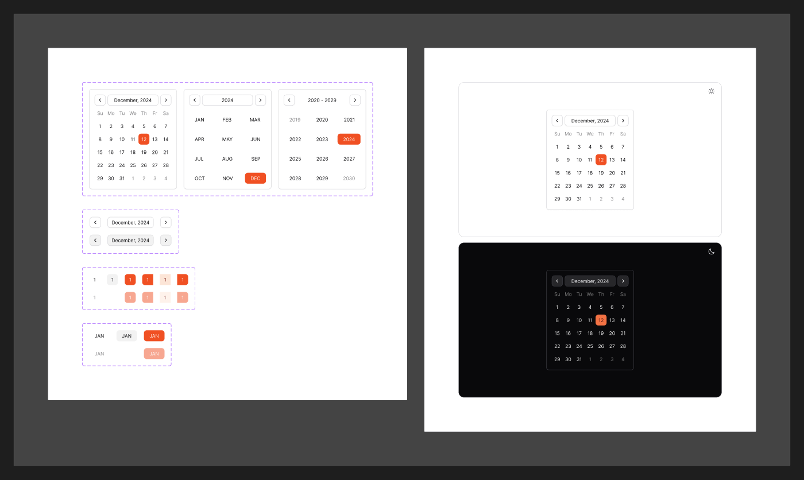

# Calendar

[← Components](./README.md) · Code: [`@mijn-ui/react-calendar`](../../packages/components/calendar)

A date grid for selecting days, months, and years.



## Figma variants

| Property | Values |
|----------|--------|
| `Type` | `Day`, `Month`, `Year`, `Main`, `Previous`, `Next` |
| `State` | `Default`, `Hovered`, `Selected`, `Start`, `Mid`, `End` |
| `isEnabled` | `false`, `true` |
| `isHovered` | `false`, `true` |

- **`Type`** — the cell/view kind: individual `Day`/`Month`/`Year` cells, the
  `Main` grid, and `Previous`/`Next` (out-of-month or adjacent cells).
- **`State`** — selection states for range selection: `Start` / `Mid` / `End`
  shape the highlighted band across a date range; `Selected` is a single date.
- **`isEnabled`** — disabled days are dimmed and non-interactive.

## Anatomy (code)

```tsx
import { Calendar, DateRange } from "@mijn-ui/react-calendar"

<Calendar mode="single" selected={date} onSelect={setDate} />
<Calendar mode="multiple" selected={dates} onSelect={setDates} />
<Calendar mode="range" selected={range} onSelect={setRange} numberOfMonths={2} />
```

`Calendar` is the main export. Range mode produces the `Start` / `Mid` / `End`
cell states from the Figma spec (`range_start` / `range_middle` / `range_end`
slots). Pairs with [Date Picker](./date-picker.md) for a popover-triggered
picker.

The calendar has no dependencies beyond React and mijn-ui: dates are plain
`Date`s compared as calendar days in the browser's time zone, and names come
from `Intl.DateTimeFormat`. Full prop reference: the
[package README](../../packages/components/calendar/README.md).

| Figma | Code |
|-------|------|
| `Type=Day` | a day cell: `day` slot on the `<td role="gridcell">`, `day_button` on its button |
| `Type=Month` / `Type=Year` | `captionLayout="dropdown"`: native month / year `<select>`s (`dropdown` slot) |
| `Type=Previous` / `Next` | days of the neighbouring months: `outside` slot, `showOutsideDays` |
| `State=Selected` | `selected` slot, `aria-selected="true"` |
| `State=Start` / `Mid` / `End` | `range_start` / `range_middle` / `range_end` slots |
| `isEnabled=false` | `disabled` matcher → `disabled` slot, native `disabled` button |

### Props

- **Selection** — `mode` (`"single"`, `"multiple"`, `"range"`), `selected`,
  `onSelect(selected, triggerDate, modifiers, event)`, `required`, `min` /
  `max` (days in multiple mode, nights in range mode).
- **Days** — `disabled` and `hidden`, each a matcher or a list of them:
  `true`, a `Date`, a `Date[]`, `{ from, to }`, `{ before }`, `{ after }`,
  `{ before, after }`, `{ dayOfWeek: [0, 6] }`, or `(date) => boolean`.
- **Months** — `month` / `defaultMonth` / `onMonthChange`, `startMonth` /
  `endMonth` (navigation bounds; the buttons are disabled at the limits),
  `numberOfMonths`, `showOutsideDays` (default `true`), `fixedWeeks`,
  `weekStartsOn` (default `0`, Sunday), `today`, `captionLayout` (`"label"`
  or `"dropdown"`).
- **Language** — `locale`, a BCP 47 tag (default `"en-US"`, the same on server
  and client), and `labels` for the previous / next buttons, the dropdowns and
  the `<nav>`.
- **Look** — `className`, `classNames` (per slot, merged into the defaults),
  `unstyled`. Everything else goes to the root `<div data-slot="calendar">`.

### Keyboard and screen readers

Each month is a `role="grid"` named by its caption; the caption is a polite live
region, so moving to another month is announced. Each day is a button named
with its full date ("Thursday, November 26, 2026"); today has
`aria-current="date"` and selected days `aria-selected="true"` on their cell.

One day takes Tab — the one that last had focus, else the first selected day,
else today, else the first enabled day. ← → move a day, ↑ ↓ a week, Home / End
to the week's first / last day, Page Up / Page Down a month, with Shift a
year; Enter and Space select. Disabled days are skipped, and moving past the
months on show moves the calendar with the focus.

### Moving off react-day-picker

Up to `@mijn-ui/react-calendar` 0.4, `Calendar` wrapped react-day-picker 9 and
brought date-fns, `@date-fns/tz` and `date-fns-jalali` with it. 0.5 is its own
implementation of the props above, with the same names and range behaviour.
These react-day-picker props are gone:

- Rendering hooks: `components`, `formatters`, `styles`, `modifiers`,
  `modifiersClassNames`, `modifiersStyles`, `dateLib`.
- Calendars and time zones: `timeZone`, `broadcastCalendar`, `ISOWeek`,
  `numerals`, `firstWeekContainsDate`, `useAdditionalDayOfYearTokens`,
  `useAdditionalWeekYearTokens`, and the Persian, Hijri, Buddhist, Hebrew and
  Ethiopic calendars.
- Layout: `footer`, `showWeekNumber`, `hideWeekdays`, `hideNavigation`,
  `disableNavigation`, `navLayout`, `reverseMonths`, `reverseYears`,
  `pagedNavigation`, `animate`, and `captionLayout="dropdown-months"` /
  `"dropdown-years"`.
- Selection: `excludeDisabled`.
- Events: `onDayClick`, `onDayFocus`, `onDayBlur`, `onDayKeyDown`,
  `onDayKeyPress`, `onDayKeyUp`, `onDayMouseEnter`, `onDayMouseLeave`,
  `onDayPointerEnter`, `onDayPointerLeave`, `onDayTouchStart`,
  `onDayTouchMove`, `onDayTouchEnd`, `onDayTouchCancel`, `onNextClick`,
  `onPrevClick`, `onWeekNumberClick` (use `onSelect`, whose second argument
  is the clicked day, and `onMonthChange`).
- Deprecated aliases: `fromDate`, `toDate`, `fromMonth`, `toMonth`,
  `fromYear`, `toYear`, `initialFocus` (use `startMonth`, `endMonth`,
  `hidden`, `autoFocus`).

And these work differently: `locale` is a language tag, not a date-fns locale,
and no longer sets the first day of the week; `labels` takes strings under new
keys; `classNames` takes the slot names listed in the README and merges rather
than replaces; the `rdp-*` class names are no longer emitted. Import
`DateRange` and `Matcher` from `@mijn-ui/react-calendar` instead of
`react-day-picker`.
