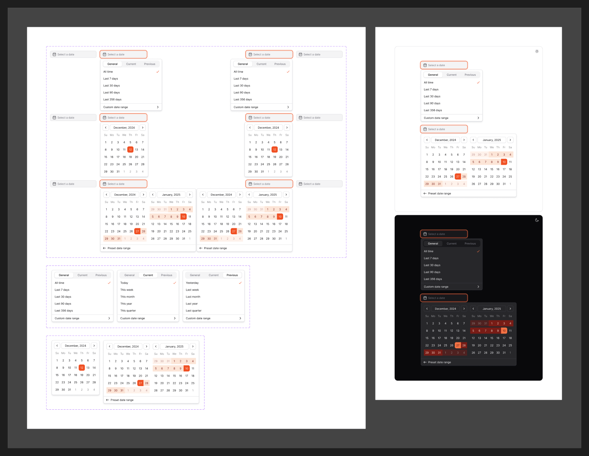

# Date Picker

[← Components](./README.md) · Code: _composed from [`react-calendar`](../../packages/components/calendar) + [`react-popover`](../../packages/components/popover)_

A trigger that opens a [Calendar](./calendar.md) in a popover to pick a date or
range.



## Figma variants

| Property | Values |
|----------|--------|
| `Type` | `Single Calendar`, `Double Calender`, `Custom Date Range`, `Preset` |
| `Active` | `General`, `Current`, `Previous` |
| `Alignment` | `Left`, `Right` |
| `isOpened` | `false`, `true` |

- **`Type`** — picker layouts: one calendar, two side-by-side calendars (for
  ranges), a custom range with inputs, or a preset list ("Last 7 days", etc.).
  _(Figma label "Double Calender" is a typo for "Double Calendar".)_
- **`Active`** — which month is in focus: `Current`, `Previous`, or general.
- **`Alignment`** — popover alignment relative to the trigger.
- **`isOpened`** — popover open/closed.

## Status

No dedicated `date-picker` package — compose it:

```tsx
import { Popover, PopoverTrigger, PopoverContent } from "@mijn-ui/react-popover"
import { Calendar, DateRange } from "@mijn-ui/react-calendar"

const [open, setOpen] = React.useState(false)
const [range, setRange] = React.useState<DateRange>()

<Popover open={open} onOpenChange={setOpen}>
  <PopoverTrigger>{/* date input / button */}</PopoverTrigger>
  <PopoverContent align="start">
    <Calendar
      mode="range"
      numberOfMonths={2}
      selected={range}
      onSelect={setRange}
      autoFocus
    />
  </PopoverContent>
</Popover>
```

- `Single Calendar` / `Double Calendar` — `numberOfMonths={1}` / `{2}`: one
  `Calendar` showing two months shares one range, one tab stop and one pair of
  previous / next buttons. (The months sit flush by default; add
  `classNames={{ months: "gap-4" }}` to space them.)
- `Custom Date Range` — `mode="range"`; `min` / `max` limit the nights, and
  `disabled` / `startMonth` / `endMonth` limit the days.
- `Preset` — buttons beside the calendar that set `range` (and `month`, if
  the calendar is controlled) to "Last 7 days" and so on.
- `align="start"` / `"end"` give the `Left` / `Right` alignment variants.
- `autoFocus` puts focus on the selected day (or today) when the popover opens,
  as the WAI-ARIA date-picker dialog pattern expects. For a single date, close
  the popover from `onSelect`.

The calendar formats in `"en-US"` unless given a `locale`; format the trigger's
text with the same language (`date.toLocaleDateString(locale)` or
`Intl.DateTimeFormat`) so the two agree.
