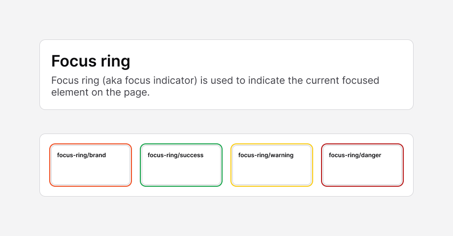

# Focus Ring

[← Foundation](./README.md)

> The focus ring (aka focus indicator) shows the **currently focused element**
> on the page. It is essential for keyboard navigation and accessibility.



## Anatomy

Each focus ring is a **two-layer shadow**:

1. A **2px gap ring** in `bg/secondary` (`#f4f4f5`) — separates the element edge
   from the colored ring so it reads cleanly against any surface.
2. A **4px colored ring** in the contextual color, drawn outside the gap.

In Figma these are drop-shadow effects with `offset (0,0)`, `radius 0`, and
`spread 2` (gap) + `spread 4` (color). The code draws the same geometry as an
outline with a transparent gap; see [Usage](#usage).

## Variants

| Token | Ring color | Hex |
|-------|------------|-----|
| `focus-ring/brand`   | `bg/brand`   | `#f05023` |
| `focus-ring/success` | `bg/success` | `#16a34a` |
| `focus-ring/warning` | `bg/warning` | `#facc15` |
| `focus-ring/danger`  | `bg/danger`  | `#b91c1c` |

> The Figma layer labels read `foucs-ring/*` (a typo for `focus-ring/*`).

## Usage

In code the ring is an **outline** 2px wide, drawn 2px outside the control,
from the `mijn-focus-ring` utility in `theme.css`. The 2px gap is transparent
rather than painted `bg/secondary`: it shows whatever surface the control sits
on, so the ring reads cleanly on the page, on a card, in a popover or in a
dialog, in light and in dark mode. (A painted gap only matches one surface; on
a raised surface in dark mode it showed as a dark band.) An outline also stays
visible in forced-colours mode, where box-shadow rings are dropped.

```tsx
// Brand focus ring on keyboard focus
<button className="rounded-md outline-none focus-visible:mijn-focus-ring">
  Save
</button>

// Contextual colour: the ring takes the element's ring-* colour
<button className="outline-none focus-visible:mijn-focus-ring focus-visible:ring-outline-danger">
  Delete
</button>
```

Swap the colour for `ring-outline-success` / `ring-outline-warning` /
`ring-outline-danger` to signal the matching state; without one the ring is
`outline-brand`. Prefer `:focus-visible` so the ring appears for keyboard users
without firing on mouse clicks. Do not combine it with
`focus-visible:outline-none`, which Tailwind orders after it and which removes
the ring.
