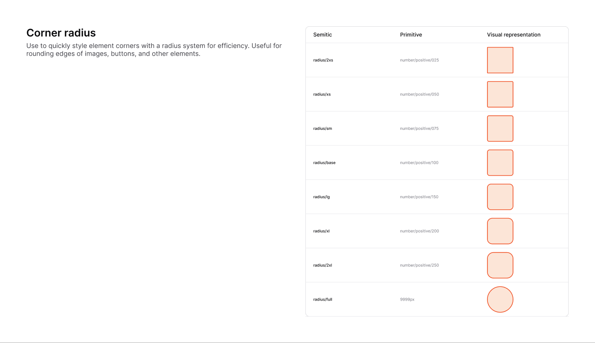

# Corner Radius

[← Foundation](./README.md)

> Use the radius system to quickly and consistently round element corners —
> images, buttons, inputs, cards, and other containers.



## Scale

Values match [`theme.css`](../../packages/core/src/theme.css) exactly. `base`
(8px) is the default for most surfaces.

| Figma token | CSS variable | Class | rem | px |
|-------------|--------------|-------|-----|-----|
| `radius/2xs`  | `--mijn-radius-2xs`  | `rounded-(--mijn-radius-2xs)`  | `0.125rem` | 2px |
| `radius/xs`   | `--mijn-radius-xs`   | `rounded-(--mijn-radius-xs)`   | `0.25rem`  | 4px |
| `radius/sm`   | `--mijn-radius-sm`   | `rounded-(--mijn-radius-sm)`   | `0.375rem` | 6px |
| `radius/base` | `--mijn-radius-base` | `rounded-(--mijn-radius-base)` | `0.5rem`   | **8px** |
| `radius/lg`   | `--mijn-radius-lg`   | `rounded-(--mijn-radius-lg)`   | `0.75rem`  | 12px |
| `radius/xl`   | `--mijn-radius-xl`   | `rounded-(--mijn-radius-xl)`   | `1rem`     | 16px |
| `radius/2xl`  | `--mijn-radius-2xl`  | `rounded-(--mijn-radius-2xl)`  | `1.25rem`  | 20px |
| `radius/full` | —                    | `rounded-full`                 | —          | pill / circle |

The tokens carry a `mijn-` prefix so they never collide with Tailwind's own
radius scale: `rounded-sm`, `rounded-lg`, `rounded-xl` … in your app keep
Tailwind's values. Write the `rounded-(--mijn-radius-*)` form rather than a
theme name: tailwind-merge resolves it against a `rounded-*` override passed in
`className`.

## Usage

```tsx
<div className="rounded-(--mijn-radius-base)">Panel (8px)</div>
<div className="rounded-(--mijn-radius-lg)">Card / dialog (12px)</div>
<span className="rounded-full">Avatar / pill</span>
```

To re-shape every component, override the tokens in your own `@theme`:

```css
@theme {
  --mijn-radius-sm: 0.25rem;
  --mijn-radius-lg: 0.5rem;
}
```

## Tailwind's scale is not changed

Up to `@mijn-ui/react-core` 0.5, `theme.css` redefined Tailwind's
`--radius-xs` … `--radius-2xl`, so importing it changed `rounded-*` across your
whole app. It no longer does:

| Class in your app | With 0.5 | Now (Tailwind default) |
|-------------------|----------|------------------------|
| `rounded-xs`  | 4px  | 2px  |
| `rounded-sm`  | 6px  | 4px  |
| `rounded-lg`  | 12px | 8px  |
| `rounded-xl`  | 16px | 12px |
| `rounded-2xl` | 20px | 16px |

`rounded-md`, `rounded-3xl` and `rounded` were never changed. `rounded-2xs`
(2px) and `rounded-base` (8px), which Tailwind does not have, are still
defined. To keep the old values in your own code, put them back in your
`@theme`; Mijn UI components are not affected either way:

```css
@theme {
  --radius-xs: 0.25rem;
  --radius-sm: 0.375rem;
  --radius-lg: 0.75rem;
  --radius-xl: 1rem;
  --radius-2xl: 1.25rem;
}
```
